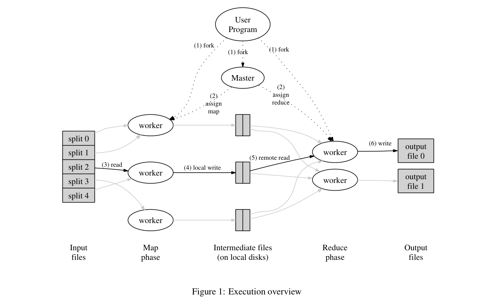

> 课程：MIT 6.5840 Distributed Systems（Spring 2026）
> 讲次：LEC 1（2026-02-03，主讲 Robert Morris）
> 材料：`LEC1/mapreduce.pdf`（Dean & Ghemawat, OSDI 2004）、讲义 `notes/l01.txt`
> 说明：本笔记总结**课程内容与论文**；实验实现细节另见 `LEC1/lab/学习笔记-MapReduce.md`。

## 一、这一讲在讲什么（一句话版）

这是全课开篇：先告诉你「分布式系统是什么、难在哪、这门课怎么上」，然后抛出贯穿全课的五大主题（容错、一致性、性能、权衡、实现），最后用一个真实系统 **MapReduce** 把这些主题全部演示一遍——它也是 Lab 1 要亲手实现的东西。


*图：MapReduce 的执行概览。图片截自课程指定阅读材料 [MapReduce 论文（OSDI 2004）](https://pdos.csail.mit.edu/6.824/papers/mapreduce.pdf) 的 Figure 1。*

---

## 二、分布式系统：是什么 / 难在哪 / 为什么学

### 2.1 定义与例子

**分布式系统 = 一群计算机协同工作来提供一种服务。**

- 常见例子：热门 App 的后端（如消息系统）、大型网站、云服务商。
- 本课聚焦**分布式基础设施**：存储（storage）、事务系统（transaction systems）、大数据处理框架（big data processing frameworks）。

### 2.2 为什么难

四个核心难点，后面每一讲都在跟它们搏斗：

| 难点 | 含义 |
|---|---|
| 并发 | 多台机器同时干活，互相干扰 |
| 复杂交互 | 组件之间的关系难以推理 |
| 性能瓶颈 | 某台机器或某条链路拖慢整体 |
| **部分失效（partial failure）** | 有的机器挂了、有的还活着——最难搞 |

### 2.3 为什么有用

1. 并行处理提升容量；
2. **复制（replication）**容忍故障；
3. 匹配物理上分散的设备（如传感器）；
4. 通过隔离提升安全性。

### 2.4 为什么学这门课

- 问题有趣，解法强大；
- 需求旺盛（大型 Web 网站兴起驱动）；
- 仍是活跃研究领域，很多问题没解决；
- 实验很有挑战性（这是这门课出名的地方）。

---

## 三、课程怎么上

- **Lectures**：论文讨论 + 背景 + 实验指导。
- **Papers**：每讲一篇研究论文（经典 + 新论文），**课前必读**，且要在上课前提交网页上的小问题答案；也可以主动提问。
- **Exams**：期中（课上）+ 期末（考试周），开卷，考论文、讲义、实验，必须参加。
- **Labs**（课程核心）：目标是深入掌握技术 + 获得分布式编程经验，第一个 lab 一周后的周五到期，之后基本每周一个。
  1. Lab 1：分布式大数据框架（类似 MapReduce）
  2. Lab 2：客户端/服务器 vs 不可靠网络
  3. Lab 3：用复制实现容错（Raft）
  4. Lab 4：容错数据库
  5. Lab 5：通过分片（sharding）实现可扩展数据库
- **评分**：用测试集打分，**所有测试都公开，没有秘密测试**。
- **期末项目**（可选）：2–3 人一组，可替代 Lab 5，需先跟老师确认选题，最后一天演示。
- ⚠️ 忠告：实验调试非常耗时，**尽早开始**，多问 Piazza、多去 TA 办公时间。

---

## 四、贯穿全课的五大主题

本课研究的是**基础设施**：存储、通信、计算。有一个贯穿一切的大目标：

> **向应用隐藏「分布式」的复杂性。**

围绕这个目标，有五个主题：

### 1. 容错（fault tolerance）

- 上千台机器 + 大网络 ⇒ 故障是常态，不是意外。
- 目标：向应用隐藏故障，实现**高可用（high availability）**——服务在故障下继续运行。
- 核心手段：**复制（replication）**。一台挂了，用其他的继续。

### 2. 一致性（consistency）

- 通用基础设施必须有明确定义的行为，例如：
  `read(x) 返回最近一次 write(x) 写入的值`。
- 难点：保证这种语义很难！比如多个副本之间很难保持完全一致。

### 3. 性能（performance）

- 目标：可扩展吞吐——N 台机器理想情况下带来 N 倍吞吐（并行用 CPU、内存、磁盘、网络）。
- 规模越大越难，例如负载不均（load imbalance）。

### 4. 权衡（tradeoffs）★ 全课最重要的思维

- **容错、一致性、性能三者互相「敌对」**：
  - 容错和一致性都需要通信（给备份发数据、检查缓存是否最新）；
  - 而通信往往慢、难扩展。
- 于是很多设计**牺牲一致性换速度**——`read(x)` 可能读到的不是最新的 `write(x)`，这对应用开发者很痛苦。
- 全课会看到大量「一致性 vs 性能」的不同设计点。

### 5. 实现（implementation）

- RPC、线程、并发控制——也就是实验里要亲手练的东西。

---

## 五、案例研究：MapReduce 论文精读

为什么第一讲就拿它开刀？讲义给了三个理由：它是五大主题的**绝佳示例**、影响力巨大（Hadoop、Spark 都源自它）、而且是 Lab 1 的主题。

### 5.1 它要解决什么问题

Google 内部有大量「**概念上很简单**」的大数据计算：倒排索引、网页图结构、每主机爬取页数统计、热门查询……数据量大到必须分散到成百上千台机器上跑。

问题在于：**并行化、数据分发、故障处理**这些脏活，会把原本几行就能写完的简单计算淹没在海量复杂代码里。

作者的设计哲学：做一个抽象，把这些脏活全藏进一个库，让**没有并行/分布式经验的程序员**也能用。灵感来自 Lisp 的 `map` / `reduce` 原语；用「用户写纯函数 + 系统负责重执行」来实现容错。

### 5.2 编程模型（论文第 2 节）

用户只需写两个函数：

```text
map    (k1,v1)        → list(k2,v2)     // 对每条输入记录产出中间 KV
reduce (k2,list(v2))  → list(v2)        // 把同一 key 的所有 value 合并
```

- `reduce` 的 value 通过**迭代器（iterator）**传入——所以即使 value 列表大到放不进内存也能处理。
- 经典例子 word count：
  ```text
  map(文档名, 内容):
      for 每个单词 w in 内容: EmitIntermediate(w, "1")
  reduce(w, values=[1,1,...]):
      Emit(sum(values))   // 数出这个词出现几次
  ```
- 更多可用此模型表达的任务（2.3 节）：Distributed Grep、URL 访问计数、反向网页链接图、每主机 term vector、倒排索引、分布式排序。

### 5.3 系统架构与执行流程（论文第 3 节，Figure 1）

角色：**一个 master（协调者）+ 多个 worker（工人）**。输入切成 **M** 份，中间 key 空间切成 **R** 份。

七步流程：

1. 库把输入切成 M 份（典型 16–64MB），在集群启动多个程序副本；
2. 一个是 master，其余是 worker；master 分配 M 个 map 任务和 R 个 reduce 任务；
3. map worker 读自己的 split，解析出 KV，调用用户的 `Map`，中间 KV 先缓存在内存；
4. 缓冲数据周期性写到**本地磁盘**，按 `hash(key) mod R` 分成 R 个区，位置汇报给 master；
5. reduce worker 从 master 拿到位置后，用 **RPC 远程读取** map worker 本地磁盘上的中间数据，按 key 排序，让相同 key 聚在一起（数据太大用外部排序）；
6. reduce worker 遍历排序后的数据，每个唯一 key 调用一次 `Reduce`，输出追加到该 reduce 分区的最终文件；
7. 全部完成后 master 唤醒用户程序。

> 论文里的 master，在本课实验里叫 **coordinator**（避免沿用带种族含义的旧词）。

### 5.4 容错（论文 3.3 节）★ 重点

**worker 失败**：master 定期 ping；无响应就标记失败。

- 该 worker 上**已完成和进行中的 map 都要重做**——因为中间结果在它的本地盘上，别人读不到；
- **已完成的 reduce 不用重做**——因为输出在全局文件系统上。

**master 失败**：理论上可以做 checkpoint 恢复，但因只有一个 master、失败概率低，原实现选择**直接中止**，客户端可重试。

**失败时的语义**：当 Map/Reduce 是输入的**确定性函数**时，分布式执行的结果等价于无故障的顺序执行。靠的是**原子提交**：

- 任务先写到私有临时文件；
- map 完成时把 R 个临时文件名发给 master（重复的完成消息忽略）；
- reduce 完成时**原子 rename** 临时文件为最终文件——即使同一任务被多台机器执行，最终文件也只含一次执行的完整结果。

> 关键责任：**Map/Reduce 必须是纯函数**（只看输入，不依赖状态、文件 I/O、交互、随机数），这是程序员的责任。

### 5.5 性能优化三板斧

1. **数据本地性（locality）**：输入由 GFS 管理（64MB 块、每块多副本）。master 尽量把 map 调度到**持有该输入副本的机器**上，让输入从本地盘读、不走网络。
2. **任务粒度（granularity）**：M、R 远大于 worker 数。任务多 ⇒ 动态负载均衡好、故障恢复快（失败 worker 的任务能摊给很多人）。代价是 master 要做 O(M+R) 调度决策、存 O(M×R) 状态。实践中 M=200000、R=5000、2000 台 worker。
3. **备份任务（backup tasks）**：拖慢整体的是「**落后者（straggler）**」——某台机器因为坏盘、资源竞争等突然变慢。作业接近完成时，master 给剩余的 in-progress 任务**再派一份备份**，主备任一完成就算完成。关闭这个机制会让 sort 慢 **44%**。

### 5.6 其它改进（论文第 4 节，了解即可）

- **分区函数**：默认 `hash(key) mod R`，可自定义（如按 URL 的主机名分区）。
- **排序保证**：每个分区内按 key 递增处理，便于生成有序输出文件。
- **Combiner**：map 端先做局部合并（要求 Reduce 可交换、可结合），大幅减少网络传输。
- **跳过坏记录**：用户代码对某些记录确定性崩溃时，可跳过这些记录继续推进。
- **本地执行**：顺序版实现，方便 gdb 调试。
- **状态页 / 计数器**：master 用 HTTP 暴露进度；计数器聚合时消除重复执行的影响，避免备份/重执行造成重复计数。

### 5.7 性能评测（论文第 5 节）

集群：约 1800 台机器（双 Xeon、4GB、双 160GB IDE、千兆网、两层树形交换、根带宽 100–200 Gbps）。

- **grep**：1TB 数据，峰值 **>30 GB/s**（1764 workers），约 150 秒（含约 1 分钟启动开销）。
- **sort**：1TB 数据，M=15000、R=4000，正常 **891 秒**；
  - 关掉备份任务：**1283 秒（+44%）**；
  - 故意杀掉 200 个 worker：**933 秒（+5%）**——容错代价极小。
- 观察：输入速率高于 shuffle 和输出速率，正是本地性优化的效果（数据从本地盘读，绕开了带宽受限的网络）。

### 5.8 影响与现状（讲义补充）

- 影响巨大：Hadoop、Spark、本课 Lab 1 都源自它。
- Google 内部大概率已不再使用，被 Flume / FlumeJava 取代；GFS 被 Colossus 取代。
- 但它的思想活了下来。

---

## 六、论文思考题（课程网页隐藏题）与解答

> **题目**：*How soon after it receives the first file of intermediate data can a reduce worker start calling the application's Reduce function? Explain your answer.*
> （reduce worker 收到第一个中间数据文件后，最快什么时候能开始调用应用的 Reduce 函数？）

**答案**：**不能**一收到第一个文件就调用 Reduce。必须等它从**所有** map worker 处收齐属于自己分区的全部中间数据，完成排序、把相同 key 聚在一起之后，才能第一次调用 Reduce。

**理由**：

1. 一个 reduce 任务负责一个 key 空间分区，它的输入是所有 M 个 map 各自产出的第 r 个分区文件，共 M 份。
2. Reduce 的语义是处理「某个 key 的**全部** value」。同一个 key 可能出现在多个不同 map 任务里（比如 "the" 遍布很多文档）。收到第一个文件就调用，后面文件里的同 key value 就丢了，结果会错。
3. 实现顺序就是「先读全、再排序、再调用」（论文 3.1 第 5、6 步）。
4. master 在每个 map 完成时增量推送中间文件位置，并在 map 重跑时通知 reduce——这也说明 reduce 必须等所有 map 的最终输出就绪。

> 注意别和 **Combiner** 混淆：Combiner 在 map 端做**局部**合并，只是减少网络传输的优化，不能替代 reduce 端「汇总全局所有 value」的语义。

---

## 七、关键数字速记

| 数字 | 含义 |
|---|---|
| 16–64 MB | 输入 split 的典型大小 |
| 64 MB | GFS 块大小，每块通常 3 副本 |
| 10 s | 本 Lab 中 coordinator 判定 worker 超时的时间 |
| 5 | 五大主题：容错、一致性、性能、权衡、实现 |
| 30 GB/s | grep 峰值读速率（1764 workers） |
| +44% | 关闭备份任务后 sort 多花的时间 |
| +5% | 杀掉 200 个 worker 后 sort 多花的时间 |
| M=200000, R=5000 | 论文实践中的任务粒度（2000 台 worker） |

---

## 八、和 Lab 1 的衔接

本讲的 MapReduce 就是 Lab 1 的原型。实验里你要实现：

- **coordinator**：派 map/reduce 任务、10 秒超时重派、判断作业完成；
- **worker**：循环领活 → 做 map（分桶写 `mr-X-Y`）或做 reduce（读全部中间文件、排序、写 `mr-out-X`）；
- **RPC**：两者之间的「短信」。

讲义里几点特别提醒：

- Map/Reduce 必须是**确定性**函数，否则重执行时不同 reduce 可能看到不同版本的 map 输出；
- 用**临时文件 + 原子 rename**，防止崩溃留下半成品；
- 任务数远多于 worker 数，才能负载均衡。

---

## 九、课后自检（不看笔记能否答出）

1. 分布式系统「难」在哪些方面？本课五大主题分别对应解决什么？
2. 为什么说容错、一致性、性能是「敌人」？举一个牺牲一致性换速度的例子。
3. MapReduce 的编程模型是什么？为什么它对程序员这么友好、限制又是什么？
4. 为什么 map worker 失败要重做已完成的 map，而 reduce worker 失败不用重做已完成的 reduce？
5. 什么是 straggler？备份任务怎么解决？
6. 为什么 `M`、`R` 要远大于 worker 数？
7. 论文思考题：reduce worker 什么时候才能开始调用 Reduce？为什么？

---

## 参考资料

- [MIT 6.5840 课程主页（Spring 2026）](https://pdos.csail.mit.edu/6.824/)
- [MIT 6.5840 课程日程（Spring 2026）](https://pdos.csail.mit.edu/6.824/schedule.html)
- [LEC 1 讲义 notes/l01.txt](https://pdos.csail.mit.edu/6.824/notes/l01.txt)
- [MapReduce: Simplified Data Processing on Large Clusters（OSDI 2004）](https://pdos.csail.mit.edu/6.824/papers/mapreduce.pdf)
- [6.5840 Lab 1: MapReduce](https://pdos.csail.mit.edu/6.824/labs/lab-mr.html)
